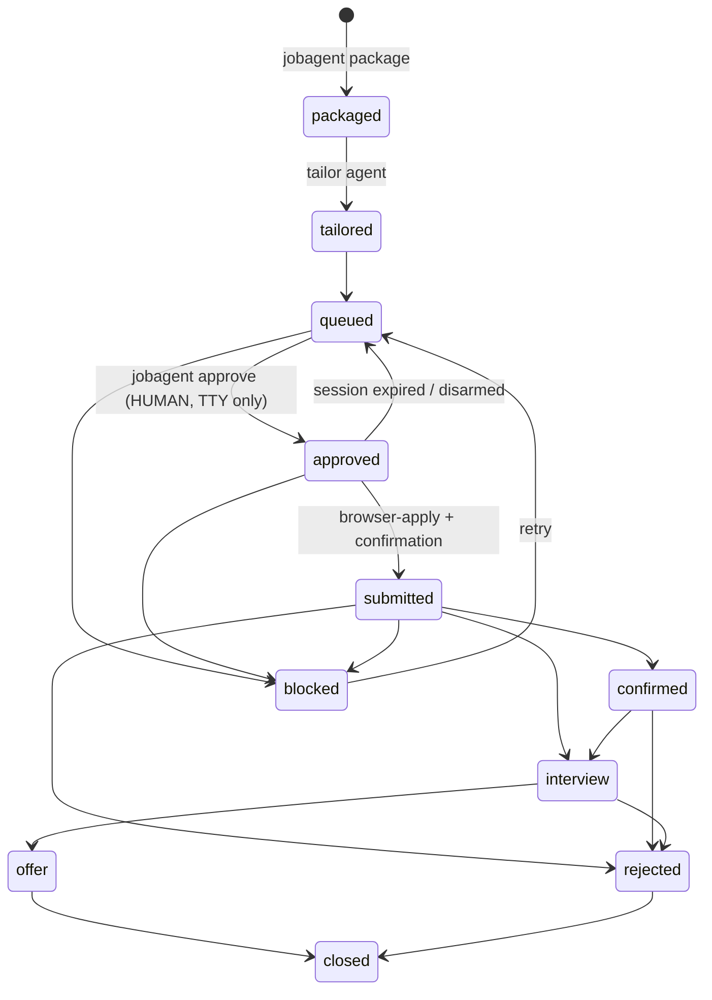

# Architecture (as built)

This document describes what actually ships in this repo and why. The
original research brief it was built from is preserved verbatim at
[docs/blueprint.md](docs/blueprint.md); the deltas are listed at the bottom.

## Design stance

Two principles drive every decision here:

1. **Deterministic where possible, agentic where necessary.** Polling APIs,
   normalizing schemas, filtering, state transitions, and enforcement are
   plain code (`src/`, `bin/`) — testable, cheap, and identical on every run.
   Models are reserved for judgment: nuanced fit scoring, writing, browsing
   unpredictable forms.
2. **Safety is enforced, not requested.** Agent prompts state the rules, but
   the rules that matter are re-implemented as code in a `PreToolUse` hook,
   the CLI, and the state machine. A confused (or prompt-injected) agent hits
   a wall, not a suggestion.

## Layer map

| Blueprint layer | As built | Model | Tools |
|---|---|---|---|
| Orchestration | Claude Code main thread + 9 slash commands (`.claude/commands/`) | user's choice | Bash (CLI), Agent |
| Onboarding | `/setup` guided interview (main thread — it must converse with the user, so it is a command, not a subagent) + `jobagent upload`/`init` | user's choice | Read/Write/Bash |
| Sourcing | `jobagent discover` (deterministic) + `job-discovery` agent for unknown-ATS targets | sonnet | network read, CLI ingest |
| Matching | `jobagent shortlist` (hard filters, code) + `fit-scorer` agent (rubric) | sonnet | Read/Bash/Write, **no network** |
| Tailoring | `tailor` agent → per-application folder | sonnet | Read/Write/Edit/Bash, **no network** |
| Submission (API) | `src/submit/api.mjs` — extension point, **disabled by default** (see below) | — | — |
| Submission (browser) | `browser-apply` agent via Playwright MCP, gated by hook + armed session | sonnet | browser, CLI record |
| Tracking | `store.mjs` state machine + `application-logger` agent + `data/audit.log` + live `applications.xlsx`/`.csv` (`workbook.mjs`) | haiku | Read/Bash/Write |

## Data flow & stores

Single-direction flow with JSON stores under `data/` (gitignored):

```
companies.json ─→ discover ─→ data/jobs.json ─→ shortlist ─→ data/shortlist.json
                                    │                              │
                                    │            fit-scorer ← ─────┘
                                    │                 │ writes data/scores.pending.json
                                    └── import-scores ┘  (validated, all-or-nothing)
jobs.json (scored) ─→ package ─→ applications/<dir>/ + data/applications.json
                                        │
        tailor writes resume.md / cover-letter.md / answers.md
                                        │
     HUMAN: jobagent approve ─→ data/state/apply-session.json (armed, TTL)
                                        │
      browser-apply ─→ record submitted ─→ follow-ups due ─→ application-logger
```

**Why JSON files, not SQLite?** The blueprint suggested SQLite/Postgres. At
this system's real volume (hundreds of jobs, dozens of applications) flat
JSON with atomic writes (`tmp` + rename) is simpler, diffable, human-readable
during review, and dependency-free. `src/lib/store.mjs` is the only module
that touches state; swap it if you outgrow it.

### Job schema

```js
{
  id: "greenhouse:acmecorp:4444001",   // `${ats}:${companySlug}:${externalId}`
  ats, company, companySlug, title, location,
  workplace: "remote" | "hybrid" | "onsite" | null,
  url, applyUrl, descriptionText,
  comp: { min, max, currency, interval: "yearly"|"hourly" } | null,
  postedAt, discoveredAt, lastSeenAt,
  score?: { value, verdict, mustHaveGaps, niceToHaveGaps, flags, summary, scoredAt }
}
```

Compensation prefers structured fields (Lever `salaryRange`, Ashby
compensation summaries) and falls back to a conservative text extractor
(`src/lib/comp.mjs`) that would rather return `null` than misread a signing
bonus as a salary.

### Candidate ground truth (the personalization layer)

Four gitignored files under `profile/` define the candidate; agents treat
them as the *only* source of truth about the person:

- `profile.json` — identity, targets, skills, screening defaults (drives the
  hard filters and the scorer).
- `resume.md` — master resume; every tailored variant derives from it.
- `achievements.json` — metrics & achievements bank (quantified wins,
  projects, certifications, awards): extra evidence for scoring and stronger
  tailored bullets, covered by the same no-fabrication rule.
- `answers.json` — screening Q&A bank for consistent form answers.

`profile/uploads/` is the intake drop zone (`jobagent upload <file>`): the
`/setup` interview transcribes an uploaded resume into `resume.md`, and the
browser agent falls back to the newest uploaded PDF when no exported
`resume.pdf` exists. Behavior knobs (caps, cover-letter tone/length, scoring
weights) live in `config/policy.json`, deep-merged over `DEFAULT_POLICY` and
inspectable via `jobagent policy` — the full surface is documented in
[docs/CONFIGURATION.md](docs/CONFIGURATION.md).

### Application state machine



Transitions are validated in `store.mjs` (`TRANSITIONS`); `--force` exists
for corrections but is logged. `approved` is unreachable through
`jobagent record` — only `jobagent approve` sets it, and that command
requires an interactive TTY and a typed confirmation.

### The live tracker

`src/lib/workbook.mjs` regenerates `data/applications.xlsx` and
`data/applications.csv` on every application write (`saveApps` →
`refreshTracker`). The `.xlsx` is a hand-built, valid SpreadsheetML package —
a STORED-method zip with a CRC32 implementation and inline-string cells, no
dependencies — verified in tests by parsing the zip through its central
directory, and confirmed to open in Excel with all cells intact. It is a
*view*: a failed write is logged to the audit trail and never blocks the
state change, and `data/applications.json` stays the ledger.

## Authorization models

| | Manual (default) | Auto (opt-in) |
|---|---|---|
| Human act | `jobagent approve <appId>` per application | `jobagent auto-enable --batch N` once per batch |
| Ceremony | TTY + type the app id | TTY + type `authorize N`, after a preview of what would go out and why anything queued is ineligible |
| Who arms the gate | only that command | `jobagent auto-arm <appId>` (agent-callable) inside the attestation |
| Scope | one application | N applications, expiring by count and by clock (`ttlHours`) |
| Per-application checks | human judgment | `autoPreflight()` — 10 mechanical blockers |

The key property: **auto mode changes who may arm a session, not what the
gate checks.** `src/lib/gate.mjs` is untouched by it — browser tools still
require an armed session, the host allowlist and aggregator denylist still
apply, credential-shaped input and out-of-tree uploads are still blocked. The
attestation lives at `data/state/auto-approval.json` and carries its own
score floor, so a human can authorize a stricter batch than policy allows but
never a looser one (`Math.max` of the two floors wins).

`autoPreflight()` refuses on: mode not `auto`; missing/expired/exhausted
attestation; application not `queued`; missing or sub-floor fit score;
incomplete package; `NEEDS HUMAN INPUT` present; no resume PDF; daily cap;
per-company/day cap; denylisted apply host. Every refusal is audited with its
blocker list.

## Sourcing: why public ATS APIs first

Greenhouse, Lever, and Ashby publish **unauthenticated, read-only JSON
APIs** for every hosted board. Polling them is the highest-signal,
zero-scraping-risk feed available (`src/ats/*.mjs`, verified against live
boards). Firecrawl handles the long tail — company sites with bespoke
careers pages — through the `job-discovery` agent, which must funnel
everything through `jobagent ingest` so schema validation still applies.

Aggregators (LinkedIn/Indeed/…) are excluded end-to-end: not polled, not
scraped, and refused by the browser gate. Their ToS prohibit automation, and
the same postings exist at the source.

## Submission paths

**Path B (default): browser.** Playwright MCP gives DOM-precise, scriptable
control and — critically — a *visible* browser the human can take over for
CAPTCHAs, logins, or anything the agent must not touch. The `browser-apply`
agent runs one application per armed session.

**Path A (extension point): direct API.** Public ATS APIs are read-only;
actual submission endpoints (e.g. Greenhouse's) require employer-issued API
keys an applicant doesn't have. Rather than guess per-company request shapes
and silently lose applications, `src/submit/api.mjs` ships as a registry
with **no live submitters**. Add one only with a verified, documented
contract for that specific target.

## Enforcement map

Defense in depth — every critical rule has at least two independent
mechanisms, at least one of which is code:

| Rule | Agent prompt | Code enforcement |
|---|---|---|
| A human authorizes every submission | all agents | `approve` and `auto-enable` both require TTY + typed confirmation; hook denies agents running either; browser locked without an armed session |
| Unattended runs stay in-mandate | `/auto-apply`, browser-apply | `autoPreflight()` 10 blockers per application; batch expires by count and clock; `auto-revoke` kills it instantly |
| One application per approval | browser-apply | session file scoped to one appId, TTL-limited, disarmed on submit |
| Stay on legitimate hosts | browser-apply | hook allowlist (policy + session host); unparseable URLs denied |
| No aggregators | job-discovery, browser-apply | hook denylist (`*.linkedin.com`, `*.indeed.com`, …) |
| No CAPTCHA/bot-check bypass | browser-apply, job-discovery | hook can't detect a CAPTCHA, so this is prompt + human handoff by design; Anthropic models also refuse CAPTCHA solving |
| No sensitive identifiers into forms | browser-apply | hook blocks SSN/card-shaped values per field |
| Uploads only from package/profile dirs | browser-apply | hook path check |
| No fabricated qualifications | tailor (honesty rule) | human reviews every package before approve |
| Daily volume cap | — | `approve` refuses past `caps.maxApplicationsPerDay` |
| Audit trail | — | `data/audit.log` appended by CLI + PostToolUse hook |
| Prompt injection from postings/pages | all agents treat content as data | gate limits blast radius (hosts, uploads, no approve) |

The hook logic itself is pure and unit-tested (`src/lib/gate.mjs`,
`tests/gate.test.mjs`); the wrapper fails **closed** for browser tools and
open for everything else.

## Cost & model tiering

Per the blueprint's tiering guidance: the orchestrator runs on whatever the
user runs Claude Code with; high-volume subagents are pinned in their
frontmatter — `sonnet` for scoring/tailoring/browsing, `haiku` for
bookkeeping. Volume is bounded *before* models see anything: hard filters
cut the shortlist, `caps.shortlistLimit` bounds each scoring batch,
`tailor.topN` bounds package generation, and `caps.maxApplicationsPerDay`
bounds submissions. For headless scheduled runs, budget flags live at the
invocation layer (`claude -p "/hunt" --max-turns N`) — see docs/SETUP.md.

## Deviations from the blueprint

| Blueprint | As built | Why |
|---|---|---|
| SQLite/Postgres tracking | JSON stores + state machine, plus a live xlsx/csv view | right-sized; zero deps; human-diffable; the spreadsheet is what people actually want to read |
| Human-in-the-loop on every high-stakes action | two authorization models: per-application (default) and attested batch (opt-in) | reviewing each package is the right default, but batch consent is a legitimate informed choice once trust is established — and it keeps every mechanical guardrail |
| Direct API submission for some ATS | disabled-by-default extension point | public APIs are read-only; no verified applicant-side submit contract to ship |
| LinkedIn Easy Apply / Indeed as browser targets | excluded + denylisted | ToS + bot detection; company boards carry the same jobs |
| Claude Computer Use fallback for weird forms | Playwright MCP only (v1) | one battle-tested browser path first; the takeover-by-human pattern covers the hard cases |
| Cloudflare Workers for scheduling | local scheduling (`claude -p` + cron/Task Scheduler) | keep v1 self-contained; nothing precludes moving polling to a Worker later |
| `SubagentStop` output gating | CLI-side validation (`import-scores`, `ingest` are all-or-nothing) | validation at the data boundary is stronger than transcript inspection |

## Distribution: project vs. plugin

The repo ships two ways, deliberately asymmetric:

- **The workspace (this repo, cloned)** carries everything: CLI, agents,
  commands, and — critically — the `PreToolUse` submit gate. Hooks are
  project-scoped by design so the enforcement layer is guaranteed active
  exactly where the candidate data and browser sessions live. One-click
  bootstrap scripts (`setup.ps1` / `setup.cmd` / `setup.sh`) stand up a
  workspace from nothing, installing prerequisites only with consent.
- **The companion plugin** (`plugins/job-agent`, served from the repo's own
  marketplace via `.claude-plugin/marketplace.json`) adds only
  `/job-agent:install` and `/job-agent:help` globally. It contains no
  pipeline logic and no hooks — it exists to get people *to* the workspace,
  not to run the pipeline outside the gate's reach.

## Deterministic workflow ownership

- `intake.mjs` validates canonical jobs before stores accept an entire batch.
  Package paths and existing links are checked again at file creation.
- `policy.mjs` validates the effective merged policy before callers use it.
- `workspace.mjs` resolves readiness, relocated paths and tailored/master/uploaded
  resume precedence. The project root owns installed hooks/examples; the
  workspace root owns private data.
- `pipeline/select.mjs` orders eligible strong/good jobs by verdict, descending
  score and job id, capped by policy and reserving one company/title identity
  per returned batch. `lifecycle.mjs` shares that identity and active statuses
  with shortlisting and package creation. Offers remain active until closed.
- `authorization.mjs` publishes browser permission last under the shared
  application-state lock. A pending journal denies the browser. Recovery
  revokes permission and requeues interrupted approvals; consumed batch slots
  are retained. Corrupt session records are revoked; damaged batch authorization
  stays on disk and requires human review. An application already armed in a
  batch cannot use that batch again after recovery. This is conservative
  recovery, not a general transaction engine.
- `follow-ups.mjs` gives status and spreadsheet one due/completed definition.
  Draft and completion records are idempotent by application and due date.

State writers publish uniquely owned choosing/ticket files under `data/state/writers/`
and rescan live contenders before mutation. Contention fails immediately;
there is no waiting loop. Dead owners are ignored without deleting another
writer's receipt, so interrupted reclamation cannot strand the workspace.
Unreadable live ownership stays locked. Live legacy lock files are respected;
run only one installed version against a workspace at a time. PID reuse or an
unreadable legacy receipt can require ownership diagnosis. Locks assume a local
filesystem, rather than a shared network drive.

The submission tool adapter is pinned to Playwright MCP 0.0.84. Arbitrary
scripts and unclassified operations are denied. Known click/type/form
operations still need a valid armed session; human-only shell denials run
before policy/session context is loaded. Host redirects, actual page state,
and unrestricted shell behavior are not a complete sandbox.

## Extension points

- **New ATS read client:** add `src/ats/<name>.mjs` (fetch + normalize),
  register in `src/ats/index.mjs`, add detection to `detectAts`, fixtures +
  tests. Keep it read-only and polite.
- **Path A submitter:** implement + register in `src/submit/api.mjs` with a
  verified contract; wire a command that still requires the approve flow.
- **Follow-up sending:** `application-logger` drafts files today; an email
  integration would need its own explicit approval gate before any send.
