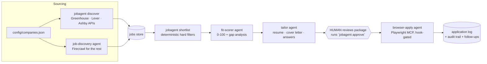

# claude-job-agent

[](https://github.com/markus41/claude-job-agent/actions/workflows/ci.yml)

An autonomous job-application pipeline built on [Claude Code](https://code.claude.com):
it **sources** openings from public ATS APIs, **scores** them against your profile,
**tailors** a resume + cover letter + screening answers per role, and — only after
**you personally approve** each application — completes the form in a real browser.

The machine does the volume. You keep the judgment, the honesty, and the submit button.

## How it works



Two layers, deliberately separated:

- **Deterministic core** (`bin/jobagent.mjs` + `src/`) — polling, normalizing,
  filtering, state, and the audit log. Plain Node 20+, zero dependencies,
  fully unit-tested. Agents *call* it; they don't reimplement it.
- **Agent layer** (`.claude/`) — five scoped subagents and eight slash
  commands orchestrated by Claude Code, with a `PreToolUse` hook that
  hard-enforces the safety rules no matter what any agent decides.

## The pipeline

| Stage | Who does it | Trust level |
|---|---|---|
| Discover | `jobagent discover` (public ATS JSON APIs) + `job-discovery` agent (Firecrawl) | Read-only network |
| Shortlist | `jobagent shortlist` — hard filters: title, workplace, comp floor, deal-breakers, staleness, already-applied | Pure code |
| Score | `fit-scorer` agent — weighted rubric, evidence-cited gaps | No network |
| Tailor | `tailor` agent — reorder & reweight the master resume, **never invent** | No network |
| Approve | **A human, in their own terminal**: `jobagent approve <appId>` | Interactive TTY required |
| Submit | `browser-apply` agent via Playwright MCP, host-allowlisted, session-armed | Hook-gated browser |
| Track | `application-logger` agent — statuses, follow-up drafts, audit | No network |

## The safety model (short version)

1. **Nothing submits without a human.** `jobagent approve` refuses
   non-interactive terminals, agents are hook-blocked from running it, and
   browser tools stay locked until an approval arms a time-boxed session for
   that one application.
2. **The browser is fenced.** Navigation is limited to allowlisted ATS hosts
   plus the approved application's own host. Aggregators (LinkedIn, Indeed,
   Glassdoor…) are refused outright — their ToS prohibit automated
   applications. File uploads may only come from `applications/` or
   `profile/`. SSN- and card-shaped input is blocked.
3. **CAPTCHAs stop the machine.** Any bot-check pauses the run and hands the
   visible browser window to the human. No solving, no bypassing, ever.
4. **The honesty rule.** Tailored materials may reorder, reweight, and
   rephrase the master resume — they may never add skills, titles, dates, or
   experience it doesn't contain. Unanswerable screening questions come back
   flagged `NEEDS HUMAN INPUT`, not guessed.
5. **Everything is auditable.** Every state change and browser action lands
   in `data/audit.log`; every submission stores the exact materials sent.

The long version — including the exact rule→enforcement mapping — is in
[docs/SAFETY.md](docs/SAFETY.md).

## Quickstart

Prereqs: Node 20+, [Claude Code](https://code.claude.com), git.

```bash
git clone https://github.com/markus41/claude-job-agent.git
cd claude-job-agent
npm test                          # 37 tests, no dependencies to install
node bin/jobagent.mjs init        # scaffold your private config + profile
```

Then:

1. Edit `profile/profile.json`, `profile/resume.md`, `profile/answers.json`
   (all gitignored — your data stays on your machine).
2. Put your target companies in `config/companies.json`
   (`node bin/jobagent.mjs detect <careers-url>` finds the ATS + slug).
3. `claude` — approve the project's Playwright MCP server when prompted, then:

```
/doctor        # verify the setup
/hunt          # discover → score → tailor → review queue
```

4. Review each package under `applications/`, approve the ones you want in
   **your own terminal**: `node bin/jobagent.mjs approve <appId>`, then run
   `/apply <appId>` and watch the browser do the typing.

Full walkthrough: [docs/SETUP.md](docs/SETUP.md).

## Commands

Slash commands (inside Claude Code): `/hunt`, `/discover`, `/score`,
`/tailor`, `/apply <appId>`, `/status`, `/follow-up`, `/doctor`.

CLI (`node bin/jobagent.mjs help`): `init`, `doctor`, `discover`, `detect`,
`ingest`, `show`, `shortlist`, `import-scores`, `package`, `approve`,
`disarm`, `record`, `status`.

## What it deliberately does NOT do

- **No LinkedIn / Indeed / aggregator automation.** Their terms prohibit it,
  bot detection makes it flaky, and the same jobs are on company boards. The
  gate refuses these hosts even if you ask nicely.
- **No CAPTCHA solving, no account-creation automation, no password entry.**
  Humans do human checks; credentials never pass through the model.
- **No auto-approve mode.** There is no configuration that submits without a
  per-application human approval. This is a feature, not a gap.
- **No fabricated qualifications.** See the honesty rule.
- **No direct-API submission by default.** Public ATS APIs are read-only;
  submission endpoints need employer-issued keys. The extension point exists
  (`src/submit/api.mjs`) for verified, documented contracts.

## Repository layout

```
.claude/            agents (5), commands (8), hooks (submit gate + audit), settings
bin/jobagent.mjs    the CLI agents and humans share
src/ats/            Greenhouse / Lever / Ashby public-API clients
src/lib/            normalize · comp parsing · filters · store · gate logic
src/pipeline/       discover · shortlist · status report
tests/              node --test suite + real-shaped fixtures
config/             companies + policy (examples committed; live files gitignored)
profile/            YOUR data (examples committed; live files gitignored)
applications/       generated per-application packages   (gitignored)
data/               job store, app log, audit trail       (gitignored)
docs/               SETUP · SAFETY · original blueprint
```

## Architecture

The design follows an orchestrator-and-subagents blueprint (the original
research brief is preserved at [docs/blueprint.md](docs/blueprint.md)); the
as-built decisions and deviations are documented in
[ARCHITECTURE.md](ARCHITECTURE.md).

## Roadmap

- More read clients: SmartRecruiters, Workable, Recruitee public endpoints
- Per-company verified API submitters (Path A) where a real contract exists
- Optional email integration for sending follow-ups (drafts stay human-sent
  until then)
- Resume PDF export helper (today: keep `profile/resume.pdf` current manually)

## License & disclaimer

MIT. You are responsible for every application submitted with this tool:
review what it writes, respect the sites you apply through, and represent
yourself truthfully. It refuses to lie for you by design.
